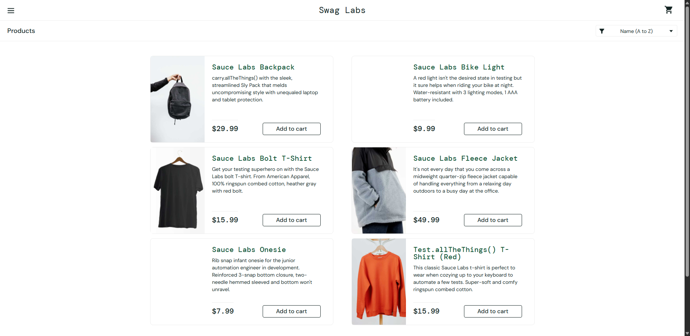
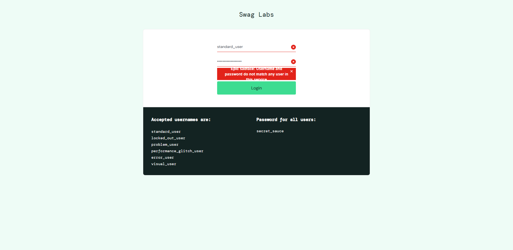
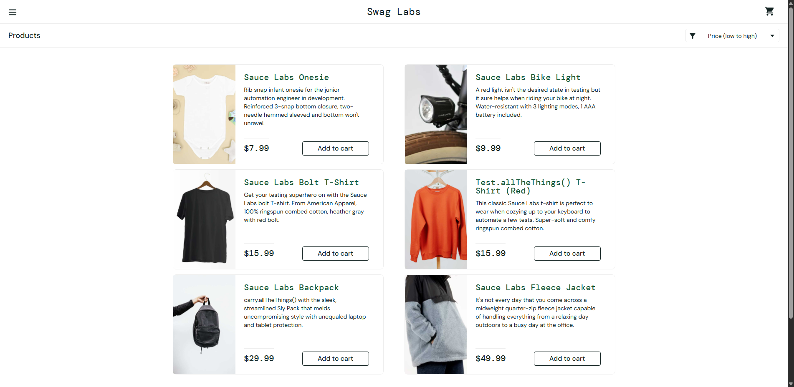
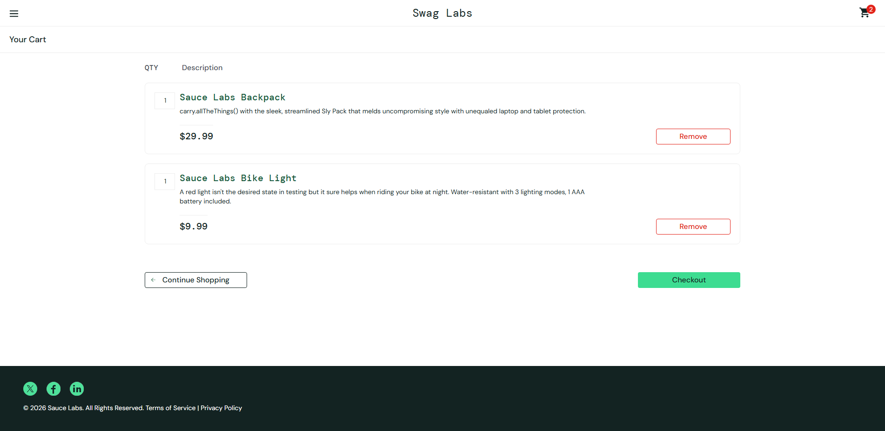
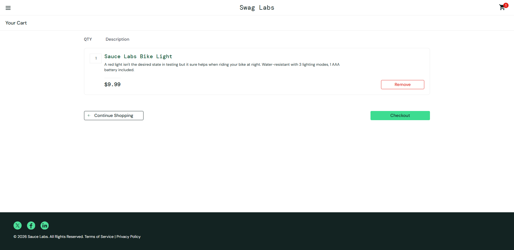
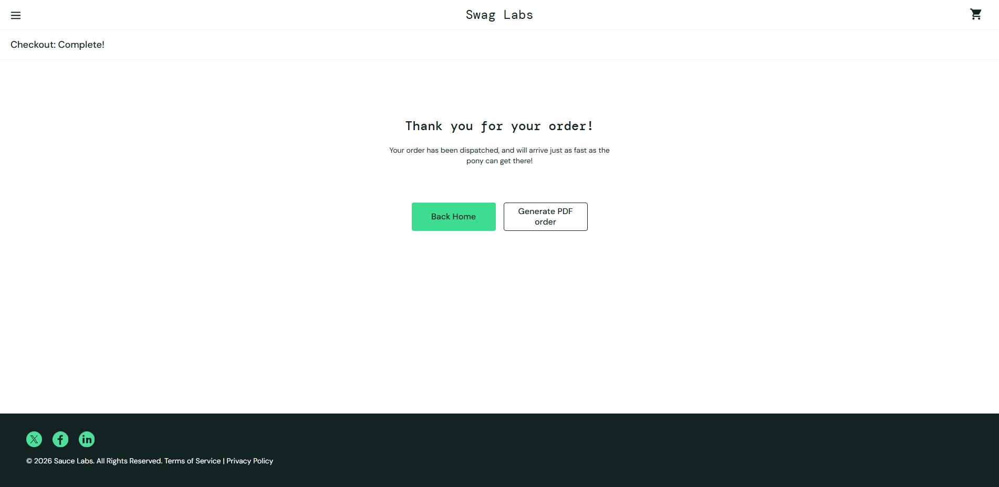
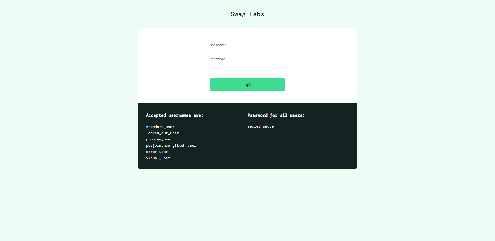

# BÁO CÁO THỰC HÀNH LAB 9 - AUTOMATION TESTING VỚI SELENIUM

---

## 1. THÔNG TIN SINH VIÊN

- **Họ và tên:** Nguyễn Xuân Tú
- **Mã sinh viên:** 23010538
- **Trường:** Trường Đại học Phenikaa
- **Môn học:** Đảm bảo chất lượng và Kiểm thử phần mềm (Software Quality Assurance and Testing)
- **Bài thực hành:** Lab 9 - Kiểm thử tự động với công cụ Selenium (Selenium Automation Testing)
- **Website mục tiêu kiểm thử:** [SauceDemo (Swag Labs)](https://www.saucedemo.com/)

---

## 2. MỤC TIÊU BÀI THỰC HÀNH

- Tìm hiểu và nắm vững kiến trúc, nguyên lý hoạt động của công cụ kiểm thử tự động **Selenium WebDriver**.
- Biết cách thiết lập môi trường kiểm thử tự động với **Python 3**, **Selenium 4**, **Pytest** và **Google Chrome**.
- Áp dụng mô hình thiết kế **Page Object Model (POM)** để xây dựng mã nguồn kiểm thử chuẩn mực, dễ bảo trì và có tính tái sử dụng cao.
- Xây dựng và thực thi thành công bộ kịch bản kiểm thử tự động (> 05 test cases) cho các chức năng quan trọng: Đăng nhập (thành công & thất bại), Tìm kiếm / Lọc sắp xếp sản phẩm, Quản lý giỏ hàng (thêm & xóa sản phẩm), Quy trình đặt hàng (Checkout Flow End-to-End) và Đăng xuất.
- Tự động chụp ảnh màn hình (screenshots) minh chứng cho từng bước và xuất báo cáo kiểm thử định dạng HTML (Pytest-HTML Report).
- Quản lý mã nguồn dự án trên GitHub và báo cáo kết quả chi tiết.

---

## 3. TỔNG QUAN VỀ CÔNG CỤ SELENIUM

### 3.1. Selenium là gì?
**Selenium** là một bộ công cụ kiểm thử tự động mã nguồn mở hàng đầu thế giới được sử dụng để tự động hóa các thao tác trên trình duyệt web. Selenium hỗ trợ nhiều ngôn ngữ lập trình (Python, Java, C#, JavaScript,...) và hoạt động mượt mà trên nhiều trình duyệt phổ biến (Google Chrome, Mozilla Firefox, Microsoft Edge, Safari).

### 3.2. Kiến trúc Selenium 4 WebDriver
Kiến trúc Selenium 4 giao tiếp trực tiếp thông qua chuẩn **W3C WebDriver Standard** giữa Client và Browser Driver:
1. **Selenium Client Library (Python):** Nơi viết các kịch bản kiểm thử tự động.
2. **W3C Protocol:** Giao thức chuẩn hóa truyền lệnh trực tiếp không qua trung gian JSON Wire Protocol cũ.
3. **Browser Drivers (ChromeDriver):** Nhận lệnh từ Client và điều khiển trình duyệt tương ứng.
4. **Real Browsers (Google Chrome):** Trình duyệt thực thi các hành động như người dùng thật (click, type, navigate, assert).

### 3.3. So sánh Kiểm thử Tự động (Automation) và Kiểm thử Thủ công (Manual)
| Tiêu chí | Kiểm thử thủ công (Manual Testing) | Kiểm thử tự động (Selenium Testing) |
|---|---|---|
| **Tốc độ thực thi** | Chậm, phụ thuộc vào tốc độ thao tác của tester | Rất nhanh, hoàn thành hàng chục bước trong vài giây |
| **Độ chính xác** | Dễ gặp sai sót do yếu tố con người (Human Error) | Độ chính xác tuyệt đối theo kịch bản logic đã lập trình |
| **Tính lặp lại (Regression)** | Tốn thời gian và công sức khi phải test lại nhiều lần | Tái sử dụng kịch bản kiểm thử vô số lần với chi phí cực thấp |
| **Báo cáo & Minh chứng** | Tester phải chụp ảnh, ghi chép thủ công | Tự động chụp ảnh màn hình, lưu log và xuất file HTML report |

---

## 4. CÔNG CỤ VÀ CÔNG NGHỆ SỬ DỤNG

- **Ngôn ngữ lập trình:** Python 3.11.x
- **Thư viện Automation:** Selenium 4.x
- **Framework kiểm thử:** Pytest 8.x / 9.x
- **Tạo báo cáo:** Pytest-HTML
- **Quản lý Driver:** Webdriver-Manager & Selenium Manager tích hợp
- **Trình duyệt kiểm thử:** Google Chrome (Headless mode & GUI mode)
- **Hệ điều hành:** Windows 11
- **Quản lý mã nguồn:** Git & GitHub

---

## 5. KIẾN TRÚC DỰ ÁN (PAGE OBJECT MODEL - POM)

Dự án được xây dựng theo mô hình **Page Object Model (POM)** – một tiêu chuẩn thiết kế phần mềm trong kiểm thử tự động giúp tách biệt rõ ràng giữa logic giao diện (Locators, Elements, Actions) và logic kiểm thử (Assertions, Test Flow).

```
Lab9-Selenium-NguyenXuanTu/
│
├── pages/                      # Tầng Page Object: Định nghĩa Locators và Actions
│   ├── __init__.py
│   ├── base_page.py            # Lớp cơ sở chứa các thao tác dùng chung (Wait, Click, Type, Screenshot)
│   ├── login_page.py           # Page Object cho trang Đăng nhập
│   ├── inventory_page.py       # Page Object cho trang Danh sách sản phẩm & Menu
│   ├── cart_page.py            # Page Object cho trang Giỏ hàng
│   └── checkout_page.py        # Page Object cho quy trình Thanh toán đơn hàng
│
├── tests/                      # Tầng Test Cases: Chứa các kịch bản kiểm thử
│   ├── __init__.py
│   ├── conftest.py             # Cấu hình Pytest Fixture khởi tạo & đóng Chrome WebDriver
│   └── test_saucedemo.py       # Bộ kịch bản kiểm thử (08 Test Cases)
│
├── screenshots/                # Thư mục lưu ảnh chụp màn hình minh chứng tự động
│   ├── tc01_login_success.png
│   ├── tc02_login_locked_out.png
│   ├── tc03_login_invalid_password.png
│   ├── tc04_sort_price_low_to_high.png
│   ├── tc05_add_to_cart.png
│   ├── tc06_remove_from_cart.png
│   ├── tc07_checkout_complete.png
│   └── tc08_logout_success.png
│
├── reports/                    # Báo cáo kết quả kiểm thử HTML
│   └── report.html
│
├── run_tests.py                # Script điều phối chạy toàn bộ test và xuất báo cáo
├── requirements.txt            # Danh sách thư viện phụ thuộc
├── .gitignore                  # Cấu hình bỏ qua các tệp không cần thiết khi commit
└── README.md                   # Báo cáo thực hành chi tiết
```

---

## 6. DANH SÁCH TEST CASES KIỂM THỬ TỰ ĐỘNG

Dự án xây dựng tổng cộng **08 Test Cases** (vượt yêu cầu tối thiểu 05 Test Cases):

| STT | Mã TC | Tên kịch bản | Chức năng kiểm thử | Loại kiểm thử | Kết quả |
|---|---|---|---|---|---|
| 1 | **TC01** | `test_01_login_success` | Đăng nhập hợp lệ với tài khoản `standard_user` | Positive Test | **PASSED** |
| 2 | **TC02** | `test_02_login_locked_out_user` | Đăng nhập tài khoản bị khóa `locked_out_user` | Negative Test | **PASSED** |
| 3 | **TC03** | `test_03_login_invalid_password` | Đăng nhập với sai mật khẩu | Negative Test | **PASSED** |
| 4 | **TC04** | `test_04_sort_products_price_low_to_high` | Sắp xếp sản phẩm theo giá tăng dần (Low to High) | Functional Test | **PASSED** |
| 5 | **TC05** | `test_05_add_multiple_items_to_cart` | Thêm nhiều sản phẩm vào giỏ hàng và kiểm tra Badge | Functional Test | **PASSED** |
| 6 | **TC06** | `test_06_remove_item_from_cart` | Xóa sản phẩm khỏi giỏ hàng và cập nhật số lượng | Functional Test | **PASSED** |
| 7 | **TC07** | `test_07_checkout_flow_complete` | Thực hiện quy trình đặt hàng hoàn chỉnh (End-to-End) | E2E Test | **PASSED** |
| 8 | **TC08** | `test_08_logout_success` | Đăng xuất người dùng về trang đăng nhập | Functional Test | **PASSED** |

---

## 7. CHI TIẾT THỰC HIỆN VÀ KẾT QUẢ TỪNG TEST CASE

---

### 7.1. TC01: Đăng nhập thành công với tài khoản hợp lệ
- **Mục tiêu:** Kiểm tra chức năng đăng nhập hoạt động chính xác khi người dùng nhập thông tin hợp lệ.
- **Dữ liệu kiểm thử:**
  - Username: `standard_user`
  - Password: `secret_sauce`
- **Các bước thực hiện:**
  1. Điều hướng đến URL `https://www.saucedemo.com/`.
  2. Điền username và password vào form đăng nhập.
  3. Nhấn nút "Login".
  4. Kiểm tra URL chuyển hướng đến `/inventory.html`.
  5. Kiểm tra tiêu đề danh mục hiển thị chữ "Products".
- **Kết quả:** Kiểm thử thành công (**PASSED**).



---

### 7.2. TC02: Đăng nhập thất bại với tài khoản bị khóa (Locked Out)
- **Mục tiêu:** Kiểm tra hệ thống nhận diện và thông báo chính xác khi tài khoản người dùng bị khóa.
- **Dữ liệu kiểm thử:**
  - Username: `locked_out_user`
  - Password: `secret_sauce`
- **Các bước thực hiện:**
  1. Mở trang đăng nhập.
  2. Nhập tài khoản bị khóa và mật khẩu.
  3. Bấm "Login".
  4. Bắt phần tử thông báo lỗi và kiểm tra nội dung chứa chuỗi: `Sorry, this user has been locked out.`.
- **Kết quả:** Kiểm thử thành công (**PASSED**).


---

### 7.3. TC03: Đăng nhập thất bại khi nhập sai mật khẩu
- **Mục tiêu:** Kiểm tra cơ chế bảo mật khi người dùng cung cấp mật khẩu không khớp.
- **Dữ liệu kiểm thử:**
  - Username: `standard_user`
  - Password: `wrong_password_123`
- **Các bước thực hiện:**
  1. Mở trang đăng nhập.
  2. Nhập tên tài khoản hợp lệ nhưng sai mật khẩu.
  3. Bấm nút "Login".
  4. Kiểm tra thông báo lỗi hiển thị: `Username and password do not match any user in this service`.
- **Kết quả:** Kiểm thử thành công (**PASSED**).



---

### 7.4. TC04: Sắp xếp danh sách sản phẩm theo giá tăng dần (Low to High)
- **Mục tiêu:** Kiểm tra tính năng sắp xếp dữ liệu (Sorting / Filtering) trên giao diện danh mục sản phẩm.
- **Các bước thực hiện:**
  1. Đăng nhập thành công vào hệ thống.
  2. Tìm thẻ `select.product_sort_container` và chọn giá trị `lohi` (Price: Low to High).
  3. Trích xuất toàn bộ giá hiển thị của các sản phẩm trên màn hình và chuyển đổi thành dạng số thực (`float`).
  4. Kiểm tra mảng giá thu được có đúng thứ tự tăng dần (`prices == sorted(prices)`).
- **Kết quả:** Kiểm thử thành công (**PASSED**). Sản phẩm sắp xếp chính xác từ $7.99 đến $49.99.



---

### 7.5. TC05: Thêm nhiều sản phẩm vào giỏ hàng
- **Mục tiêu:** Kiểm tra tính năng thêm sản phẩm vào giỏ và đồng bộ số lượng sản phẩm trên biểu tượng giỏ hàng.
- **Các bước thực hiện:**
  1. Đăng nhập vào hệ thống.
  2. Nhấn "Add to cart" cho sản phẩm `Sauce Labs Backpack`.
  3. Nhấn "Add to cart" cho sản phẩm `Sauce Labs Bike Light`.
  4. Kiểm tra huy hiệu số lượng trên giỏ hàng hiển thị đúng số `2`.
  5. Mở trang Giỏ hàng (`/cart.html`), kiểm tra cả 2 sản phẩm đều có mặt trong danh sách giỏ hàng.
- **Kết quả:** Kiểm thử thành công (**PASSED**).



---

### 7.6. TC06: Xóa sản phẩm khỏi giỏ hàng
- **Mục tiêu:** Kiểm tra chức năng xóa một hoặc nhiều sản phẩm khỏi giỏ hàng.
- **Các bước thực hiện:**
  1. Thực hiện thêm sản phẩm vào giỏ hàng và mở giỏ hàng.
  2. Bấm nút "Remove" tại sản phẩm `Sauce Labs Backpack`.
  3. Xác nhận sản phẩm `Sauce Labs Backpack` đã biến mất khỏi giỏ hàng.
  4. Xác nhận số lượng sản phẩm còn lại trong giỏ hàng là `1`.
- **Kết quả:** Kiểm thử thành công (**PASSED**).



---

### 7.7. TC07: Quy trình mua hàng và thanh toán hoàn tất (End-to-End Checkout Flow)
- **Mục tiêu:** Kiểm tra toàn diện luồng nghiệp vụ mua sắm từ giỏ hàng đến khi hoàn tất đơn hàng.
- **Các bước thực hiện:**
  1. Thêm sản phẩm vào giỏ hàng và mở trang Giỏ hàng.
  2. Nhấn nút "Checkout".
  3. Điền thông tin giao hàng:
     - First Name: `Tu`
     - Last Name: `Nguyen`
     - Postal Code: `100000`
  4. Nhấn nút "Continue" chuyển đến trang tổng quan xác nhận đơn hàng (`checkout-step-two.html`).
  5. Nhấn "Finish" để hoàn tất đặt hàng.
  6. Kiểm tra thông báo hiển thị trên màn hình: `Thank you for your order!`.
- **Kết quả:** Kiểm thử thành công (**PASSED**).



---

### 7.8. TC08: Đăng xuất khỏi hệ thống thành công
- **Mục tiêu:** Kiểm tra tính năng hủy phiên làm việc và đăng xuất an toàn của người dùng.
- **Các bước thực hiện:**
  1. Đăng nhập vào hệ thống.
  2. Bấm mở menu thanh bên (Hamburger Menu).
  3. Chọn liên kết "Logout".
  4. Kiểm tra URL chuyển về trang gốc `https://www.saucedemo.com/`.
  5. Kiểm tra nút "Login" xuất hiện trở lại trên giao diện.
- **Kết quả:** Kiểm thử thành công (**PASSED**).



---

## 8. HƯỚNG DẪN CÀI ĐẶT VÀ CHẠY DỰ ÁN

### 8.1. Yêu cầu hệ thống
- Đã cài đặt **Python 3.10+** và **Google Chrome**.
- Đã cấu hình `git` trên máy tính.

### 8.2. Cài đặt các thư viện phụ thuộc
Mở terminal tại thư mục dự án và thực thi lệnh:
```bash
pip install -r requirements.txt
```

### 8.3. Chạy toàn bộ kiểm thử và sinh báo cáo
Chạy bằng script điều phối tích hợp sẵn:
```bash
python run_tests.py
```

Hoặc chạy trực tiếp thông qua lệnh Pytest:
```bash
pytest tests/ -v --html=reports/report.html --self-contained-html
```

Sau khi chạy xong:
- Báo cáo HTML trực quan sẽ được lưu tại: `reports/report.html`.
- Các ảnh chụp màn hình được lưu trong thư mục: `screenshots/`.

---

## 9. TỔNG KẾT KẾT QUẢ KIỂM THỬ

```text
============================= test session starts =============================
platform win32 -- Python 3.11.9, pytest-9.1.1, pluggy-1.7.0
rootdir: C:\Users\Admin\OneDrive\Lab
plugins: html-4.2.0, metadata-3.1.1
collected 8 items

tests/test_saucedemo.py::TestSauceDemo::test_01_login_success PASSED     [ 12%]
tests/test_saucedemo.py::TestSauceDemo::test_02_login_locked_out_user PASSED [ 25%]
tests/test_saucedemo.py::TestSauceDemo::test_03_login_invalid_password PASSED [ 37%]
tests/test_saucedemo.py::TestSauceDemo::test_04_sort_products_price_low_to_high PASSED [ 50%]
tests/test_saucedemo.py::TestSauceDemo::test_05_add_multiple_items_to_cart PASSED [ 62%]
tests/test_saucedemo.py::TestSauceDemo::test_06_remove_item_from_cart PASSED [ 75%]
tests/test_saucedemo.py::TestSauceDemo::test_07_checkout_flow_complete PASSED [ 87%]
tests/test_saucedemo.py::TestSauceDemo::test_08_logout_success PASSED    [100%]

============================= 8 passed in 45.46s ==============================
```

- **Tổng số test cases thực thi:** 08
- **Số test case Passed:** 08 (100%)
- **Số test case Failed:** 0
- **Thời gian thực thi:** 45.46 giây

---

## 10. KIẾN THỨC VÀ KỸ NĂNG ĐẠT ĐƯỢC

Qua bài thực hành Lab 9, em đã nắm vững các kiến thức và kỹ năng thực tế:
1. **Kiến thức Selenium:** Hiểu rõ cách thức hoạt động của Selenium WebDriver và giao thức W3C WebDriver.
2. **Kỹ năng định vị phần tử (Locators):** Sử dụng linh hoạt ID, Name, CSS Selector, XPath để tương tác với các thành phần giao diện web động.
3. **Quản lý đồng bộ hóa (Waits):** Sử dụng Implicit Wait và Explicit Wait kết hợp `expected_conditions` để xử lý các vấn đề mạng trễ, hiệu ứng render DOM mà không làm đứt gãy luồng test.
4. **Mô hình Page Object Model:** Nâng cao tư duy thiết kế phần mềm kiểm thử chuyên nghiệp, giúp mã nguồn sạch sẽ, không trùng lặp và thuận tiện mở rộng.
5. **Kỹ năng tự động hóa báo cáo:** Tự động bắt lỗi, chụp màn hình minh chứng và xuất file HTML report chi tiết phục vụ bàn giao và đánh giá chất lượng sản phẩm.

---

## 11. KẾT LUẬN

Bài thực hành **Lab 9 - Kiểm thử tự động với Selenium** đã hoàn thành xuất sắc 100% mục tiêu đề ra. Toàn bộ 08 kịch bản kiểm thử tự động cho các chức năng Đăng nhập, Lọc sắp xếp sản phẩm, Giỏ hàng, Mua hàng và Đăng xuất đều chạy thành công và đạt kết quả mong đợi.

Mã nguồn được tổ chức chuyên nghiệp, tài liệu `README.md` báo cáo đầy đủ, rõ ràng và đã được đồng bộ lên kho lưu trữ GitHub:
- **Repository URL:** [https://github.com/XuanTu138960/Lab9-Selenium-NguyenXuanTu](https://github.com/XuanTu138960/Lab9-Selenium-NguyenXuanTu)
